  

## Hi, I'm Mohammed 👋

I build fast, serverless web platforms on **Cloudflare**, algorithmic trading systems on **MetaTrader 5**, and automation that takes repetitive work off the table.

My rule is simple: **data decides.** Every idea gets measured, and if it doesn't hold up, it gets cut.

---

### ⚡ What I build

<table>
<tr>
<td width="33%" valign="top">

**🏢 Staffly** 
A Saudi talent-sourcing and staffing platform, running fully on Cloudflare (Pages · Workers · D1).  
<a href="https://staffly.cc">staffly.cc →</a>

</td>
<td width="33%" valign="top">

**📈 Algo Trading Lab** 
MQL5 Expert Advisors for gold and indices. Strict filter: real-tick backtests, PF ≥ 1.2 across separate market regimes, and no martingale or grid recovery.

</td>
<td width="33%" valign="top">

**🤖 Automation & AI** 
An MCP server that connects MT5 to AI agents, a broker-latency lab, and agents running on cloud VPS.

</td>
</tr>
</table>

### 🛠 Stack

  
  
  
  
  
  

🇸🇦 Saudi Arabia · <a href="https://staffly.cc">staffly.cc</a>

